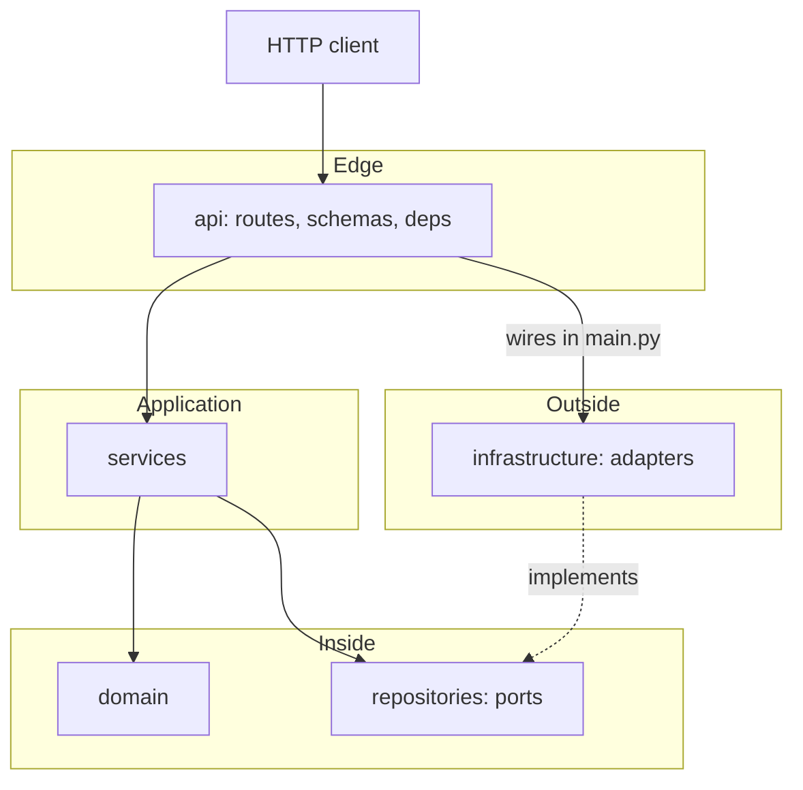
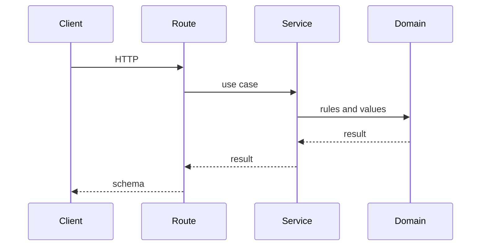

# Contributing

This is one deployable FastAPI service. `master` is the only long-lived branch. Every change starts from a ticket, lands on a short-lived branch, and merges back to `master` through a pull request.

This directory is not a git repository until you create one:

```bash
git init -b master
```

Do not add a long-lived `develop` branch.

## Architecture

Dependencies point inward. Outer layers may call inner layers. Inner layers do not import outer layers.



A request moves in one direction:



When a use case needs storage or another system, the service calls a port. The adapter that talks to PostgreSQL, a queue, or another HTTP API lives in `infrastructure` and is constructed in `app/main.py` or `app/api/deps.py`.

### Layers

| Layer | Path | Owns | Must not |
| --- | --- | --- | --- |
| Composition | `app/main.py` | Build the app, mount routers, register handlers | Business rules |
| API | `app/api/` | Routes, dependency wiring, middleware, HTTP errors | SQL, business decisions |
| Schemas | `app/schemas/` | Request and response bodies | Domain rules |
| Services | `app/services/` | Use cases | FastAPI, database drivers |
| Domain | `app/domain/` | Values and rules that stay true without a framework | FastAPI, SQLAlchemy, HTTP |
| Ports | `app/repositories/` | Interfaces services depend on | Driver imports |
| Adapters | `app/infrastructure/` | Database, queues, outbound clients | HTTP status codes |
| Core | `app/core/` | Settings, logging, application errors | Feature logic |

`GET /health` is the reference path: route to `HealthService` to `HealthReport` to `HealthResponse`.

Probes stay unversioned (`/health`). Business routes mount under `/api/v1` from `app/api/v1/router.py`. A breaking change to a public contract gets `/api/v2`. It does not rewrite v1 in place.

Errors leave the process as one envelope:

```json
{
  "error": {
    "code": "not_found",
    "message": "Resource not found",
    "request_id": "..."
  }
}
```

Raise `AppError` (or `NotFoundError`, `ConflictError`) from services. The API layer turns that into HTTP. Every response carries `X-Request-ID`.

### Where a new feature goes

Example: patient profile.

1. Domain value in `app/domain/patients.py`.
2. Port in `app/repositories/patients.py` (`get`, `add`, whatever the use case needs).
3. Adapter in `app/infrastructure/repositories/patients.py`.
4. Use case in `app/services/patients.py`. The service receives the port in `__init__`.
5. Schemas in `app/schemas/patients.py`.
6. Route in `app/api/v1/endpoints/patients.py`. Include it from `app/api/v1/router.py`.
7. Provider in `app/api/deps.py` that builds the adapter and passes it to the service.

The route reads input, calls one service method, and returns a schema. Conditionals that decide business outcomes belong in the service or the domain.

Persistence arrives with the first feature that stores data. The planned adapter is PostgreSQL, SQLAlchemy, and Alembic, behind a repository port. Do not import the driver from `services` or `domain`.

### Import rules

Allowed:

- `api` → `services`, `schemas`, `core`
- `services` → `domain`, `repositories`, `core`
- `infrastructure` → `repositories`, `domain`, `core`
- `main` and `api/deps` → anything, because they are the composition root

Forbidden:

- `domain` → `api`, `services`, `infrastructure`
- `services` → `api`, `infrastructure`
- `schemas` → `services`

## Tickets

Create a ticket before a branch. Use the GitHub issue forms in `.github/ISSUE_TEMPLATE/`.

Id: `HB-<issue number>`. GitHub assigns the number when the issue is opened. Put that id in the title.

Title:

```text
[HB-12] Add patient profile endpoint
```

Types:

| Type | Use when |
| --- | --- |
| Feature | New or extended behavior |
| Bug | Current behavior breaks an expectation |
| Chore | Tooling, dependencies, or repo structure, no product change |

A feature or chore ticket body has:

- **Context** — why the work exists
- **Goal** — the outcome
- **Acceptance criteria** — statements that are true or false when the work is done
- **Out of scope** — what this ticket will not do
- **Technical notes** — layers, data, risks, if already known

A bug ticket body has: summary, steps to reproduce, expected, actual.

One ticket, one outcome. Split work that would touch unrelated areas.

## Branches

`master` is protected in practice: no direct pushes for feature work. Branch from an up-to-date `master`.

```text
<type>/HB-<number>-<kebab-summary>
```

| Type | Branch prefix | Merges to |
| --- | --- | --- |
| Feature | `feature/` | `master` |
| Bug | `bugfix/` | `master` |
| Production break that cannot wait | `hotfix/` | `master` |
| Tooling or repo structure | `chore/` | `master` |
| Documentation only | `docs/` | `master` |

Examples:

```text
feature/HB-12-add-patient-profile
bugfix/HB-18-fix-health-status
hotfix/HB-21-reject-expired-token
chore/HB-7-pin-runtime-dependencies
docs/HB-9-document-patient-api
```

Rules:

- The number matches the ticket.
- The summary is short, lowercase, and uses hyphens.
- Delete the branch after the pull request merges.
- Open the next branch from `master`, not from another feature branch.

## Commits

[Conventional Commits](https://www.conventionalcommits.org/):

```text
feat(patients): add profile read

HB-12
```

Types: `feat`, `fix`, `chore`, `docs`, `refactor`, `test`. The scope is the area (`patients`, `health`, `api`). The footer is the ticket id.

## Pull requests

Open a pull request into `master`. Use `.github/PULL_REQUEST_TEMPLATE.md`.

- The description names the ticket.
- The diff stays inside the layers the ticket needs.
- Behavior changes include tests: unit tests for services and domain, API tests when HTTP changes.
- `pytest` passes.

Review looks for the dependency rule first, then correctness. A route that contains a business decision goes back for a move into the service.

## Tests

```bash
pytest
```

| Place | Covers |
| --- | --- |
| `tests/unit/` | Services and domain, no HTTP server |
| `tests/api/` | Routes through `TestClient` |

## Local run

Setup and the server command are in `README.md`. Architecture questions belong in this file. If a change breaks a rule here, update this file in the same pull request.
